# 简体中文 | [English](./README-en.md)

<div align="center">
  

  <br />

  # 临音 (Lain)

  _"数字世界里的私人音乐绿洲。"_

</div>

临音是一个面向本地曲库与自建媒体服务的跨平台音乐播放器，支持 Android、iOS、Windows、Linux 与 macOS。

目前支持的音源：
- 本地
- WebDAV
- Navidrome
- Emby
- 飞牛音乐（特别感谢 [huya688zdx](https://github.com/huya688zdx) 的贡献）

## 本次版本更新

### 车机与媒体会话
- 蓝牙/车机广播随切歌即时更新，标题、艺术家与时长不再滞后。
- 封面可选服务器封面地址、本机中继、内容提供器或仅位图；广播使用压缩后的缩略图。
- 广播歌词可单独开关：开启时主行显示当前歌词，副行为「艺术家 - 标题」。
- 局域网内可由手机直接向车机提供封面，不依赖车机访问服务器。

### 播放
- 播放模式：点按在列表循环与随机播放之间切换，长按进入单曲循环，队列中标记正在单曲循环的歌曲。
- 音量归一化支持关闭、按单曲与按专辑，读取文件中的 ReplayGain 标签，混合曲库不再忽大忽小。
- 播放速度可在 0.5x 到 2.0x 之间选择，播放中立即生效。
- 淡入淡出可单独开关：开始时渐入，暂停与切歌时渐出。
- 音频焦点提供独占、智能避让、混合三种模式：独占被打断只暂停、不自动恢复；避让在打断结束后恢复原音量。
- 播放队列支持拖动排序、下一首播放、稍后播放、整队反转与队列页查看；清空队列后会显示撤销入口，可恢复并继续播放。
- 通知栏、锁屏与车机上的播放进度每秒更新；Navidrome 与 Emby 的服务器端“正在播放”同步曲目、进度与暂停状态。
- 新增全屏驾驶模式：封面模糊背景随主题变化，支持横竖屏，横屏歌词页也可进入。

### 曲库与浏览
- 多服务器管理：每个服务器可配置公网与局域网地址、独立证书选项，支持 Feiniu；地址可自动切换，默认打码显示。
- 新增服务器状态页：连接状态、地址与延迟、速度优先选路、服务器信息与媒体统计，并可直接让服务器立即扫描曲库。
- 全局搜索；首页可搜索歌曲、专辑、艺术家与歌单。
- 专辑与艺术家页支持排序、专辑优先、曲目序号与专辑简介；艺术家图片按服务器信息与本地缓存统一决定。
- 歌曲列表支持多种排序并记住每个列表的选择；新增最近添加、播放次数排序与品质标识。
- 歌单支持导入、导出、重命名，保留添加顺序；歌单封面取当前排序下的第一首。
- 评论：歌曲菜单入口、评论服务器、分页、热门/最新/时间排序、搜索、楼层回复与评论显示设置。
- 更名 Lain（临音），补充本地音乐与离线模式控制。
- 本地曲库支持自动增量扫描：启动后、回到前台或到达设定间隔时检查文件夹，只重新读取修改过的文件。
- 本地歌曲的“歌曲信息”“搜索标签”“搜索歌词”“编辑元数据”合并为一个信息面板：可编辑标签并应用，搜索标签后回到面板，歌词可搜索或用时间轴编辑后返回；音频格式、码率与路径在同一页展示。
- 首页新增随机播放列表：每次刷新抽取 100 首；流媒体源可选择使用服务器随机列表，关闭或服务器不可用时从本机已保存歌曲中抽取，本地曲库直接本地随机。
- 新增曲库体检页：汇总缺标签、缺封面、缺歌词的歌曲，并按标题、艺术家与时长效验疑似重复项；页内只做检查，不修改或删除文件。
- 离线模式可选择使用本地曲库，或继续使用当前服务器已缓存的歌曲；数据库不裁剪，退出离线模式后无需重新同步。

### 缓存与下载
- 自动缓存可分别控制歌曲、歌单与艺术家。
- 缓存目录与下载目录均可自定义，修改时询问是否迁移已有文件。
- 缓存上限支持不限、1/2/5/8 GB，超出后按最旧顺序淘汰。
- 缓存任务逐曲显示等待、缓存中、暂停、完成、失败，可单曲暂停、继续、删除，也可整体停止或清空。
- 缓存按音乐源选择的在线音质与转码格式执行，任务页显示该音质与格式。
- 下载支持选择码率；移动网络下进入队列，连上 Wi-Fi 或打开应用后自动继续，并显示下载进度。
- 下载管理页包含任务队列与已完成记录，支持单任务和全局的继续、暂停、删除；已完成记录显示封面。
- 新增局域网直连开关：局域网内直接连接服务器，不转码、不读缓存。

### 首页与统计
- 首页作为单一入口，支持自定义按钮与分区顺序；新增最近添加、Navidrome 统计卡片与全局搜索。
- 桌面小组件提供 2x2、4x2 两种布局，显示封面与播放进度。
- 听歌报告包含年度统计、月度热力图、热门歌曲/专辑/艺术家；播放达到三分之二即计一次。

### 界面
- 浅色、深色、生动三套主题；歌曲列表可显示 HR/SQ/HQ 品质标识，生动主题有独立配色。
- 设置与主页布局支持长按拖动排序；评论与歌词相关设置重新归类。
- 服务器、元数据编辑等表单统一为应用内的分组卡片样式；歌词页提供统一字号控制。
- 歌曲列表与专辑/艺术家/歌单列表加载时显示骨架占位，页面布局不再跳动。
- 切歌时封面交叉淡入；专辑、艺术家与歌单从列表打开详情时共享封面过渡。
- 歌词页封面在播放时轻微呼吸，左右滑动切换歌词页时带有视差位移；可在设置 → 用户界面中关闭“歌词页封面动效”。
- 拖动进度条时在上方显示目标时间，播放进度按帧平滑推进而不是逐秒跳动。
- 歌曲列表与播放器的三点菜单统一为底部卡片式操作面板：顶部歌曲信息卡，下方无分隔线的操作卡片，操作间距一致。
- 播放器菜单内可直接调整音量归一化、播放速度、淡入淡出开关与音频焦点模式，无需返回设置页；歌曲信息卡与歌曲列表一样带复制按钮。
- 设置中可关闭服务器播放进度上报：关闭后不再定时同步“正在播放”和位置，完成播放的计数仍保留。


## 关于本工程

临音是基于 [Sylvakru](https://github.com/AfalpHy/sylvakru)（原 Particle Music）的**二次开发**工程，原工程由
[AfalpHy](https://github.com/AfalpHy) 创建。本仓库作为**独立工程**维护，有独立的应用标识、独立的发行渠道和独立的
发展方向，也不再自动跟随上游仓库的改动。

上游工程是这里一切的基础，本仓库从它的最后一个提交出发，在此之上继续演进。本工程仍以与上游相同的许可证开源——
[Apache License 2.0](./LICENSE)；上游的版权声明保留在 [NOTICE](./NOTICE) 中，本工程所做的每一处改动都记录在
git 历史里，并在各版本的发行说明中汇总。

## 支持的格式

| 文件格式 | 元数据格式                   |
|----------|------------------------------|
| AAC (ADTS) | `ID3v2`, `ID3v1`           |
| Ape        | `APE`, `ID3v2`\*, `ID3v1`  |
| AIFF       | `ID3v2`, `Text Chunks`     |
| FLAC       | `Vorbis Comments`, `ID3v2`\* |
| MP3        | `ID3v2`, `ID3v1`, `APE`    |
| MP4        | `iTunes-style ilst`        |
| MPC        | `APE`, `ID3v2`\*, `ID3v1`\* |
| Opus       | `Vorbis Comments`          |
| Ogg Vorbis | `Vorbis Comments`          |
| Speex      | `Vorbis Comments`          |
| WAV        | `ID3v2`, `RIFF INFO`       |
| WavPack    | `APE`, `ID3v1`             |

\* 因官方不支持，该类标签**只能读取**。

## 音频处理

- [audio_tags_lofty](https://github.com/AfalpHy/audio_tags_lofty.git) —— 读写音频标签（基于 lofty）
- [media_kit](https://github.com/media-kit/media-kit.git) —— 音频播放（基于 mpv/FFmpeg）

## 运行与构建

按照 [Flutter 官方安装文档](https://docs.flutter.dev/install/manual) 安装 Flutter。

### Ubuntu / Debian

```shell
# Flutter 依赖：
sudo apt install clang lld cmake ninja-build pkg-config libgtk-3-dev liblzma-dev libsecret-1-dev

# 音频库
sudo apt install libmpv-dev

git clone git@github.com:me1dlinger/lain.git
cd lain
# 检查开发环境
flutter doctor -v
# 调试运行
flutter run
# 发布模式运行
flutter run --release
# 构建
flutter build linux
# 需要 .deb 包
flutter build linux && ./generate_deb.sh

# 需要 .rpm 包
sudo apt install rpm
flutter build linux && ./generate_rpm.sh
```

### Windows

安装 [Visual Studio](https://visualstudio.microsoft.com/)。

```shell
git clone git@github.com:me1dlinger/lain.git
cd lain
# 检查开发环境
flutter doctor -v
# 调试运行
flutter run
# 发布模式运行
flutter run --release
# 构建
flutter build windows
```

### macOS 与 iOS

按照 [Apple 开发者下载页](https://developer.apple.com/download/all/) 安装 Xcode 与命令行工具。

```shell
git clone git@github.com:me1dlinger/lain.git
cd lain

# 安装 CocoaPods
brew install cocoapods

# 检查开发环境
flutter doctor -v
# 调试运行
flutter run
# 发布模式运行
flutter run --release
# 构建
flutter build macos

# 构建未签名的 ipa
flutter build ios --release --no-codesign && \
mkdir -p Payload && \
cp -r build/ios/iphoneos/Runner.app Payload/ && \
zip -r lain.ipa Payload && \
rm -rf Payload
```

### Android

安装 [Android Studio](https://developer.android.com/studio) 与 Android SDK 命令行工具。

```shell
git clone git@github.com:me1dlinger/lain.git
cd lain
# 接受 SDK 许可
flutter doctor --android-licenses
# 检查开发环境
flutter doctor -v
# 调试运行
flutter run
# 发布模式运行
flutter run --release
# 构建
flutter build apk
# 按 ABI 拆分
flutter build apk --split-per-abi
# 构建 TV 版
flutter build apk --dart-define=TV=true
```

本工程 Android 侧需要的工具链说明（`compileSdk 37.0`、JDK 17、小内存机器下调低 Gradle 堆）见
[BUILDING.md](./BUILDING.md)。

## 截图

### 移动端

- iPhone
<div>
    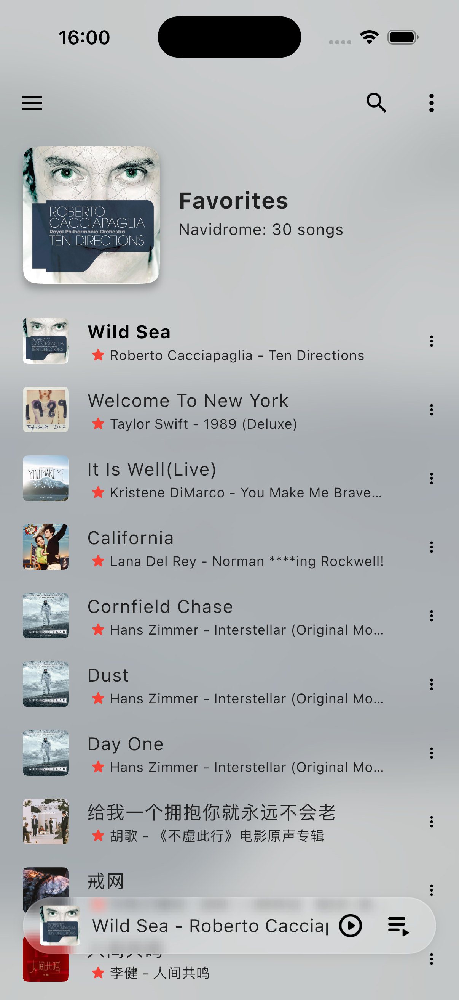
    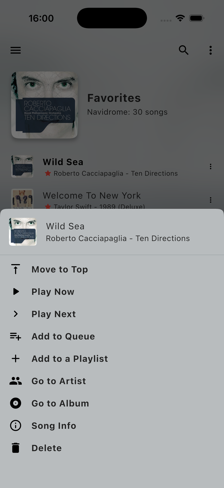
    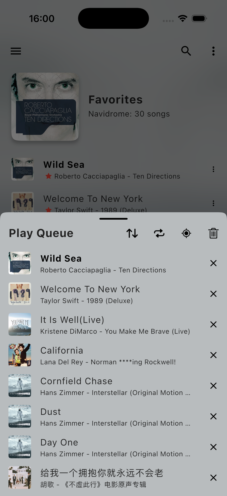
</div>

<div>
    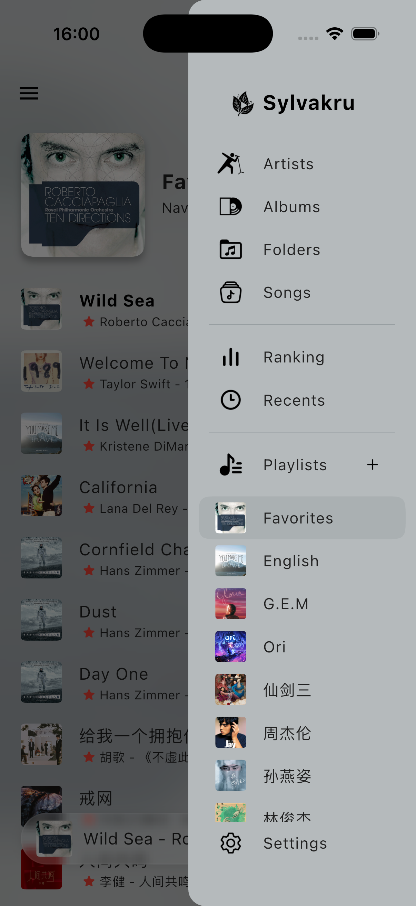
    
    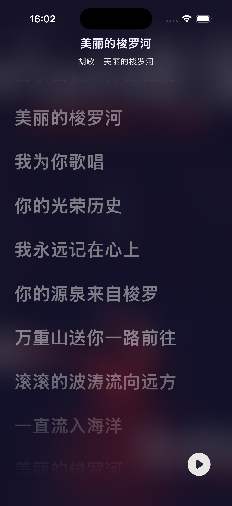
</div>

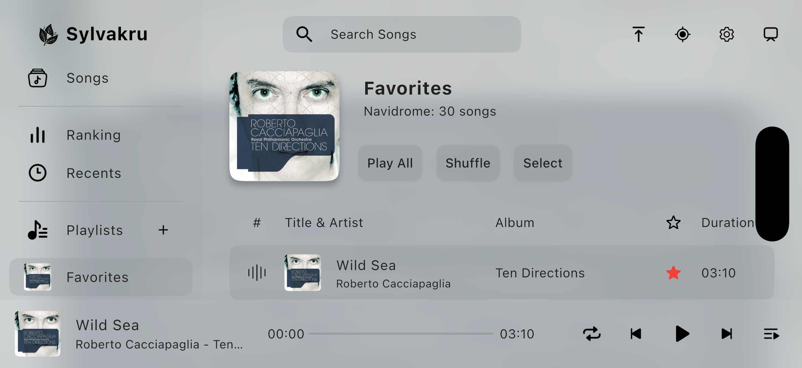
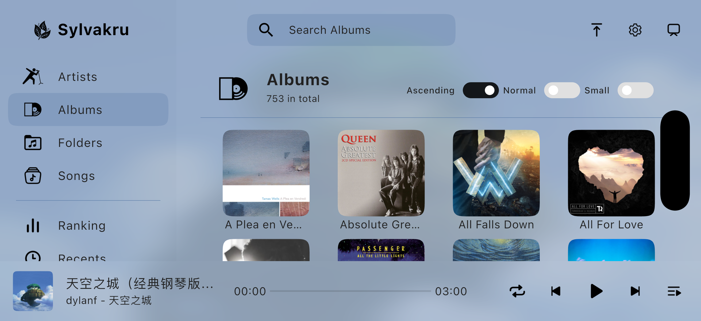
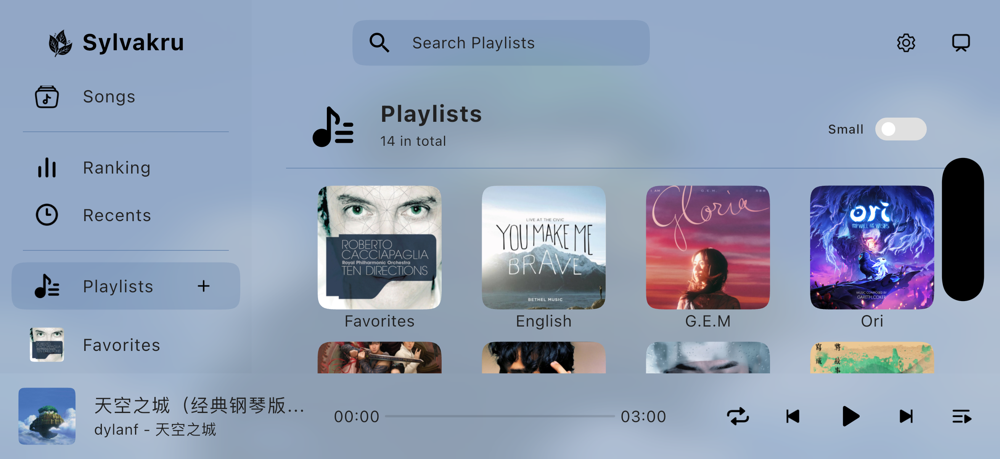

- iPad

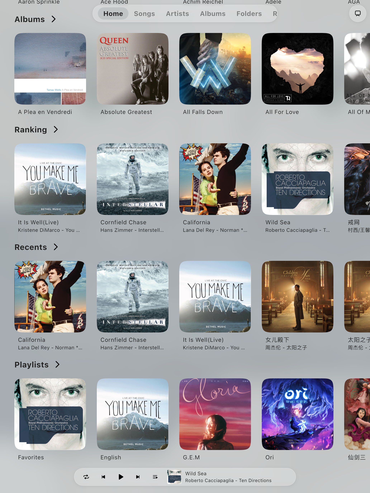
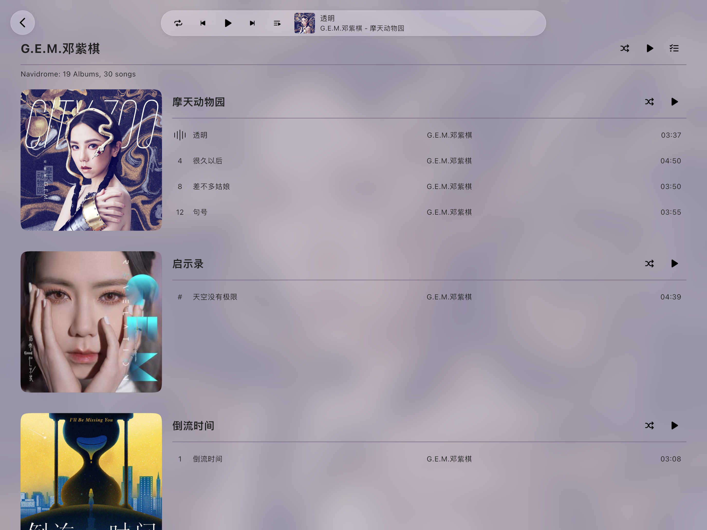
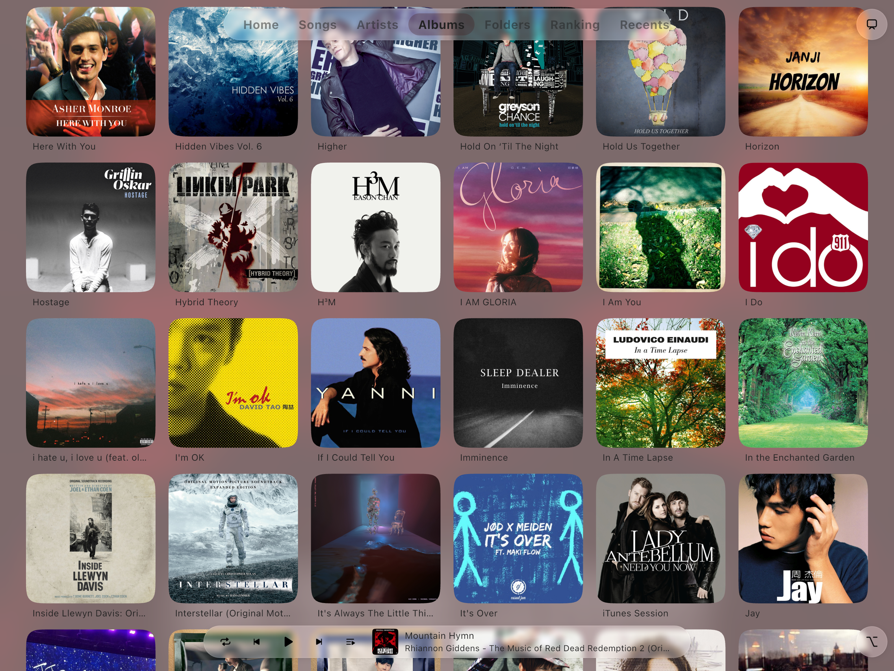
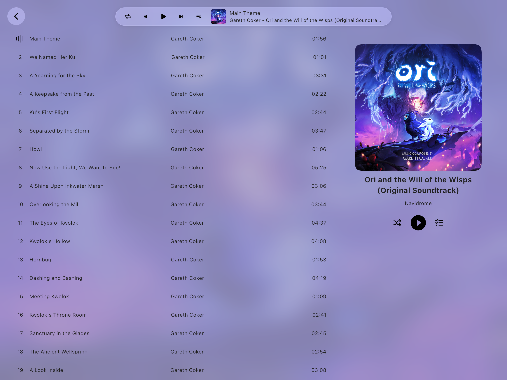

### 桌面端


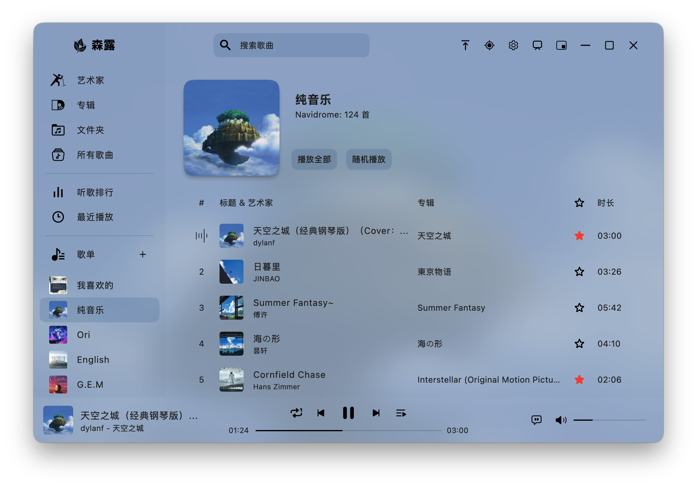
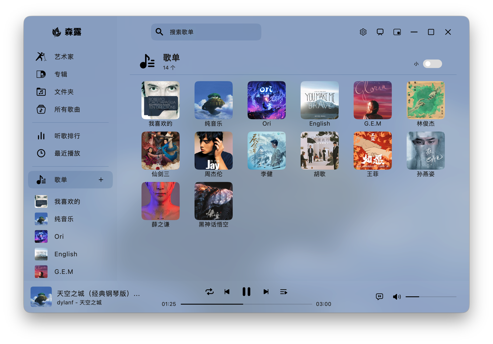
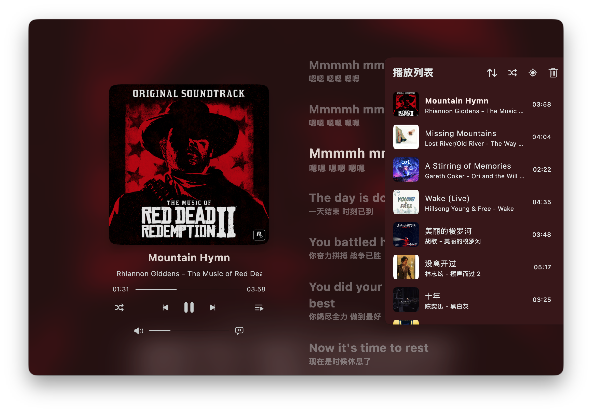


## 许可证

[Apache License 2.0](./LICENSE)。临音是基于 [AfalpHy](https://github.com/AfalpHy) 的
[Sylvakru](https://github.com/AfalpHy/sylvakru) 的二次开发工程，上游版权声明见 [NOTICE](./NOTICE)。
